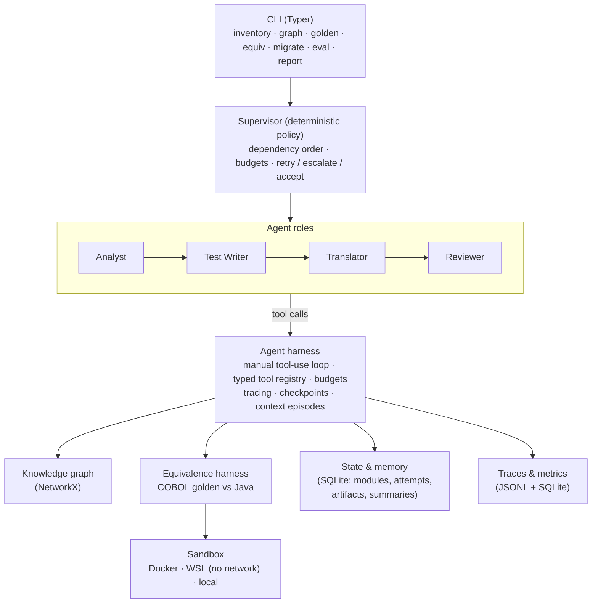

# cobalt

**AI agents that migrate legacy COBOL batch programs to Java 21 - and prove every
migration by running the original COBOL and the new Java on the same inputs and
diffing the outputs.**

Banks, insurers and governments still run their core on COBOL. Migrations stall for three
reasons: programs are tangled together (copybooks, CALLs, shared files), COBOL arithmetic
and formatting are subtle (packed decimal, ROUNDED vs truncation, edited PICs, REDEFINES),
and nobody trusts a rewrite without proof. cobalt attacks all three:

| Problem | cobalt's answer |
|---|---|
| interdependence | a **code knowledge graph** gives dependency-ordered migration waves and exactly the context each agent needs |
| subtle semantics | **specialised agents** (Analyst, Test Writer, Translator, Reviewer) and a small Java runtime for COBOL numerics |
| trust | an **equivalence harness**: golden outputs from the real COBOL (GnuCOBOL), byte-level normalised diff, first divergence named down to the COBOL field |

The agent harness is hand-built on the Anthropic Messages API - no agent framework.

---

## Architecture



**Per module, in knowledge-graph order (callees first):** the Analyst writes a precise
analysis; the Test Writer adds edge-case inputs whose expected outputs come from the
original COBOL; the Translator iterates *write - compile - run equivalence - fix* until every
case passes; the Supervisor re-runs equivalence itself, applies static checks (no floating
point near money, no embedded expected output) and asks the Reviewer for idiomatic Java.
Failed attempts are retried with the failure evidence, the last attempt is escalated
(bigger budget, `xhigh` effort, optionally a stronger model), and modules whose callees
failed are blocked. Accepted modules are **folded** into compact summaries for later
callers. Everything is persisted, so a killed run resumes without redoing work.

### Components

| Package | What it does |
|---|---|
| `cobalt.inventory` | classifies every corpus file; lexical scan of each program; scope (`now` / `later` / `out`) |
| `cobalt.graph` | COPY-expanding parser (REPLACING, continuation lines), record layouts with byte offsets, paragraphs, PERFORM/GO TO flow, CALL / CICS LINK, file I/O; typed graph; migration order (SCC-collapsed waves), context retrieval, impact analysis; JSON / GraphML / DOT / Mermaid export |
| `cobalt.sandbox` | one contract, three backends: **Docker** (no network, read-only root, memory/CPU/PID caps), **WSL** (rootless `unshare -rn` network namespace, `timeout`, `prlimit`), **local** (inside the dev container) |
| `cobalt.equivalence` | golden capture with source/input digests; javac/java runner; file adapters for INDEXED (BDB, alternate keys) and record-SEQUENTIAL files; JCL PARM drivers; pinned clock; volatile-field masking; normalised diff naming the first divergent record, column and COBOL field |
| `cobalt.harness` | the agent loop (streaming, explicit effort, prompt caching, server-side refusal fallback), strict typed tools, budgets, failure taxonomy, loop and misuse detection, traces, atomic checkpoints, offline replay provider |
| `cobalt.agents` | role prompts, tool subsets and budgets; the Supervisor; static checks |
| `cobalt.memory` | SQLite migration state; folded module summaries; context composition tracking and append-only episode compaction |
| `cobalt.evals` | metrics, ablation suite, failure taxonomy, static HTML report |
| `java-runtime/` | `cobalt.migrated.support`: `Pic` (MOVE truncation, ROUNDED, COBOL-like division, SIZE ERROR, edited PICs), `LineFiles`, `CobolClock` |

---

## Quick start

### With Docker (reference environment)

```bash
cp .env.example .env           # add ANTHROPIC_API_KEY for live agent runs
make build                     # Python 3.12, GnuCOBOL 3, OpenJDK 21, Maven
make corpus                    # fetch AWS CardDemo at a pinned commit
make smoke                     # sandbox, golden reproducibility, equivalence, CLI
make demo                      # end to end, offline (scripted replay)
make demo LIVE=1               # end to end with the real model
make test lint
```

### On Windows without Docker (WSL)

```bash
python -m venv .venv && .venv/Scripts/pip install -e ".[dev]"
wsl -d Ubuntu --exec bash scripts/wsl_toolchain.sh   # rootless GnuCOBOL 3.2 + JDK 21
.venv/Scripts/python scripts/smoke.py
.venv/Scripts/python scripts/demo.py
```

`cobalt sandbox` shows which backend is in use (`COBALT_SANDBOX=auto|docker|wsl|local`).

### Commands

```bash
cobalt inventory                         # what is in the corpora, what is in scope
cobalt graph build -c carddemo           # parse + build the knowledge graph
cobalt graph order -c carddemo           # migration waves (callees first)
cobalt graph context INTCALC             # exactly what an agent gets for one program
cobalt graph impact ACCTREC              # what to re-verify if a copybook changes
cobalt golden -c carddemo                # golden outputs from the original COBOL
cobalt equiv                             # reference Java vs golden
cobalt migrate --provider anthropic      # multi-agent migration (default: all programs)
cobalt migrate --run-id RUN              # resume a killed run
cobalt status RUN; cobalt runs           # per-module status, attempts, spend
cobalt eval --provider anthropic         # ablations: full / no-graph / no-folding / neither
cobalt report EVAL_ID                    # static HTML report
```

---

## Corpora

**Synthetic** (`corpus/synthetic/`, committed): `CUSTRPT` (control breaks, edited PICs),
`INTCALC` + `RATECALC` (static CALL, ROUNDED division, SIZE ERROR), `TXNPOST` (balance-line
match/merge, HIGH-VALUES) and `PAYROLL` (REDEFINES record variants, ROUNDED vs deliberate
truncation, `$` and `CR` editing, hash-total control). Seeded data plus 10 edge cases.

**AWS CardDemo** (fetched at a pinned commit, Apache-2.0): 44 programs, 30k lines.
The inventory classifies 14 as batch (3 sequential-only, 11 VSAM) and 30 as CICS / DB2 /
IMS / MQ (graph analysis only). Seven batch programs run off the mainframe
(`corpus/carddemo-support/`): `CBACT02C`, `CBACT03C`, `CBCUS01C` (VSAM reads), `CBTRN01C`
(validation), `CBTRN02C` (posting: indexed I-O, rejects, balance updates), `CBTRN03C`
(date-range report over the posted file, as the JCL chains it) and `CBACT04C` (interest
calculation with a JCL PARM and an alternate-key VSAM file).

---

## Results

What has been **measured** in this repository:

| Check | Result |
|---|---|
| Synthetic programs compiled and run under GnuCOBOL 3.2 | 4 main + 1 subprogram, 14 test cases, golden outputs reproducible byte for byte |
| Hand-written reference Java vs golden | **14/14 cases pass** (`cobalt equiv`) |
| Harness catches semantic bugs | a truncate-instead-of-ROUNDED mutation fails with *INTOUT record 1, column 40, field INT-INTEREST* (`tests/test_equivalence.py`) |
| CardDemo batch subset run off-mainframe | **7 programs**, deterministic golden outputs (indexed + sequential files, pinned clock) |
| Multi-agent pipeline end to end (scripted replay provider) | **5/5 synthetic modules accepted** through Analyst - Test Writer - Translator - Reviewer, including Test Writer cases verified against new COBOL golden outputs |
| Kill and resume | interrupted runs resume from checkpoints without redoing accepted modules or tool calls (`tests/test_supervisor.py`) |
| Ablation pipeline (replay) | without the graph, `INTCALC` is attempted before its callee and fails to build: 4/5 vs 5/5 |
| Test suite | 180 tests, including sandbox integration tests |

What has **not** been measured yet: **live model results.** No API key was available while
building this, so the success rate, attempts, cost and the ablation effect of *real agents*
are still to be produced:

```bash
cobalt eval --provider anthropic -c synthetic     # then: cobalt report <eval-id>
cobalt eval --provider anthropic -c carddemo
```

The replay provider is useful for exercising the pipeline, but it re-enacts reference
migrations; its numbers say nothing about model capability, and every report it produces
says so.

---

## Engineering notes

- **Correctness first.** Money is `BigDecimal`; MOVE truncation, ROUNDED (half away from
  zero), intermediate division precision and SIZE ERROR are matched exactly. The
  equivalence harness, not the agent, decides acceptance.
- **Isolation.** Every compile and run happens in a fresh job directory inside the sandbox
  with no network; agents can only write their module's Java package (and, for the Test
  Writer, test inputs).
- **Observability.** Every LLM call (tokens incl. cache reads/writes, cost, duration, stop
  reason) and tool call is traced to JSONL and SQLite; secrets are redacted at the source.
- **Determinism.** Pinned dependencies and base data, seeded generators, fixed clocks,
  content-addressed build caches, stable tool ordering for prompt caching.
- **Append-only conversations.** Current Claude models bind thinking to the exact
  conversation, so context management starts a new *episode* with a folded digest rather
  than editing history.

See [docs/WRITEUP.md](docs/WRITEUP.md) for the design write-up and [CLAUDE.md](CLAUDE.md)
for the project brief.
